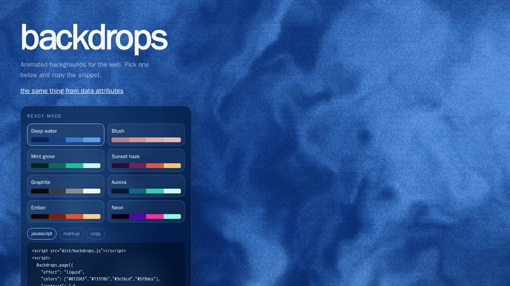
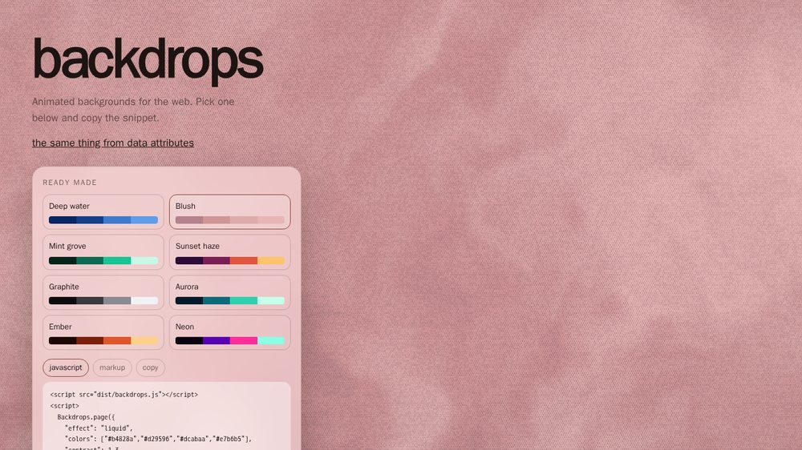
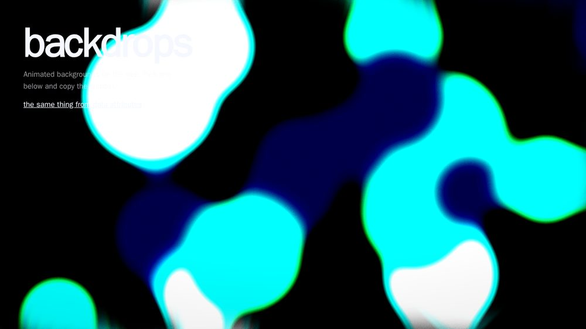

# backdrops

Animated backgrounds for the web. A liquid noise field, halftone dots and film grain, driven by one config
object. No dependencies, no build step for you: one script tag, or one import.





## Use it

Full page, behind your content:

```html
<script src="dist/backdrops.js"></script>
<script>
  Backdrops.page({
    colors: ['#072563', '#133f8b', '#3e7bcd', '#5f9dea'],
    scale: 2.25,
    speed: 1
  });
</script>
```

As a module:

```html
<script type="module">
  import Backdrops from './src/backdrops.js';
  const host = Backdrops.page({ colors: ['#04231a', '#0b6b52', '#17c493', '#c9f7e7'] });
</script>
```

Inside one element, with no JavaScript of your own:

```html
<section data-backdrop="liquid"
         data-backdrop-colors="#2b0b3a,#7a1f56,#e0563f,#ffc36b"
         data-backdrop-scale="3"
         data-backdrop-dots-pitch="4">
  <h1>Your page</h1>
</section>
<script src="dist/backdrops.js"></script>
<script>Backdrops.ready();</script>
```

The layer never eats clicks, so your content stays fully usable.

## What you can change

Everything. Colours, geometry, texture, motion, quality.

| Option | Default | What it does |
| --- | --- | --- |
| `effect` | `'liquid'` | which engine draws (see below) |
| `colors` | blue ramp | up to 8 colours, mapped across the field |
| `background` | `'#0d1114'` | page colour behind the layer and behind the fallback |
| `scale` | `2.25` | zoom of the noise field |
| `speed` | `1` | how fast the field flows, `0` freezes it |
| `contrast` | `1.4` | pushes the field away from the middle of the ramp |
| `warp` | `3` | how much the field folds into itself |
| `octaves` | `4` | detail, `1` is soft, `6` is busy |
| `grain` | `0.85` | film grain |
| `vignette` | `0.12` | darkening at the edges |
| `seed` | `0` | shifts the dot texture |
| `quality` | `1.25` | maximum render scale, `1` means one device pixel |
| `maxPixels` | `1300000` | hard ceiling on the buffer size |
| `dots.on` | `true` | halftone dots on or off |
| `dots.pitch` | `3.2` | grid step in pixels |
| `dots.size` | `1.35` | dot size, relative to the grid step |
| `dots.jitter` | `0.5` | how much each dot wanders off centre |
| `dots.base` | `0.74` | baseline dot coverage |
| `dots.gain` | `0.6` | how much the field modulates the dots |
| `dots.color` | darkest stop | dot colour |
| `dots.shade` | `0.86` | how much the dot colour is darkened |
| `debug` | `null` | `'field'` shows the raw noise, useful when tuning |
| `views` | `{}` | named sets of options, for themes |
| `theme` | `null` | `'auto'` follows `themeAttribute` or the system |
| `themeAttribute` | `'data-theme'` | attribute read from `<html>` |
| `themeFade` | `700` | cross fade between views, in ms |
| `stillFrame` | `12` | the frame drawn when motion is reduced |
| `pauseWhenHidden` | `true` | stop in a background tab |
| `reducedMotion` | `'still'` | `'still'`, `'slow'` or `'ignore'` |
| `autoplay` | `true` | start on its own |
| `fallback` | `'gradient'` | `'gradient'` or `'none'` when WebGL is missing |

## Themes

Give the same options two names and switch the attribute you already use:

```js
Backdrops.page({
  theme: 'auto',
  themeAttribute: 'data-theme',
  views: {
    dark: { colors: ['#072563', '#133f8b', '#3e7bcd', '#5f9dea'], contrast: 1.5, grain: 0.9 },
    light: { colors: ['#b4828a', '#d29596', '#dcabaa', '#e7b6b5'], contrast: 1.3, grain: 0.7 }
  }
});
```

Setting `data-theme` on `<html>` fades one view into the other, colours included.

## Runtime

```js
const host = Backdrops.page(options);
host.set({ scale: 4 });            // any option, applied at once
host.colors(['#000', '#0af']);     // shorthand
host.view('light');                // switch a named view
host.pause(); host.play();
host.redraw();                     // draw a single frame
host.stats();                      // fps, frames, mode, buffer size, view, logs
host.destroy();                    // remove everything it created
```

## On pages that care

- `prefers-reduced-motion: reduce` draws one still frame and stops.
- The loop pauses in a hidden tab.
- The render scale drops by itself when frames get slow, and comes back when they are fast.
- No WebGL means a CSS gradient built from the same colours, or nothing at all.
- The canvas is `aria-hidden` and `pointer-events: none`.

## Other effects

`Register` an engine once and it behaves like the built-in one: the host keeps the canvas, the loop, the
sizes, the themes and the fallback, and the engine only draws.

```js
Backdrops.register({
  id: 'waves',
  api: '2d',                       // or 'webgl'
  defaults: { speed: 1 },
  mount(ctx) {                     // ctx: canvas, config, palette, log
    return {
      draw(state) {},              // state: time, frame, still
      resize(size) {},             // size: w, h, dpr
      setConfig(config, palette) {},
      dispose() {}
    };
  }
});
Backdrops.page({ effect: 'waves' });
```

`Backdrops.effects()` lists what is loaded. Two engines ship today:

| Engine | Draws | Needs |
| --- | --- | --- |
| `liquid` | domain warped noise, colour ramp, halftone dots, grain | WebGL |
| `goo` | soft blobs that melt into each other | Canvas 2D, canvas filters |

`liquid` options on top of the shared ones: `scale`, `contrast`, `warp`, `octaves`, `grain`, `dots.*`,
`seed`, `debug: 'field'`.
`goo` options: `blobCount`, `blobSize`, `spread`, `wobble`, `softness`, `blur`, `threshold`,
`background`, `renderScale`, `debug: 'raw'`.

## Gallery

`demo/index.html` shows eight ready made looks on both engines. Pick one and the snippet for it is right
there, in JavaScript or as data attributes.

## Development

```bash
npm test          # unit tests for config, palette and the builds
npm run build     # writes dist/backdrops.mjs and dist/backdrops.js from src/
npm run serve     # the playground from demo/ on http://localhost:8080
```

`src/backdrops.js` is the whole library and runs in a browser as it is. `dist/backdrops.js` is the same
code wrapped for a plain `<script>` tag, and is generated, never edited.

## License

BSD-3-Clause
